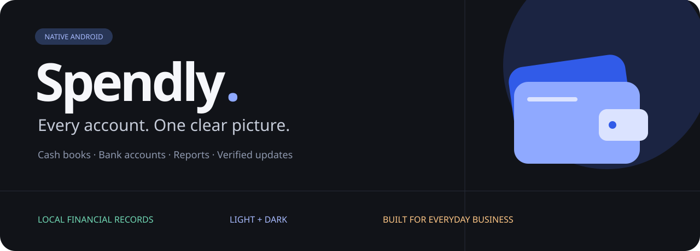
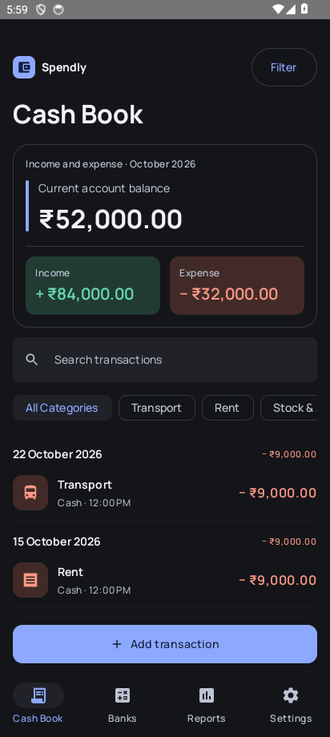
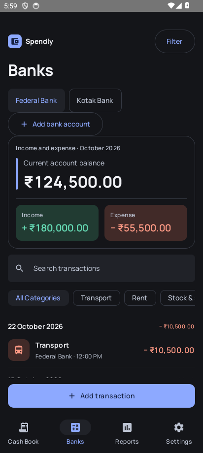
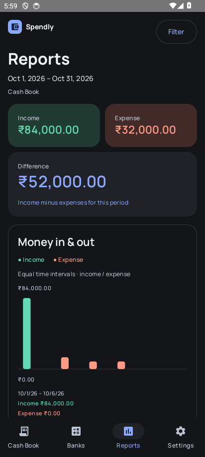
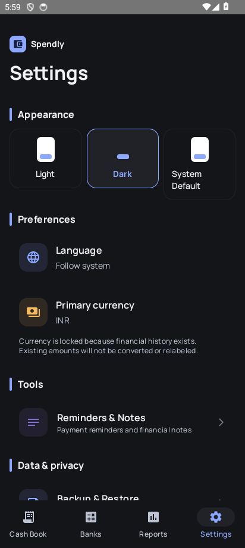
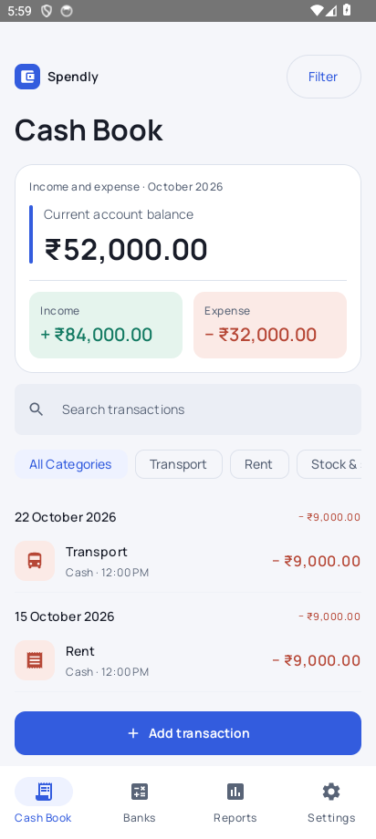
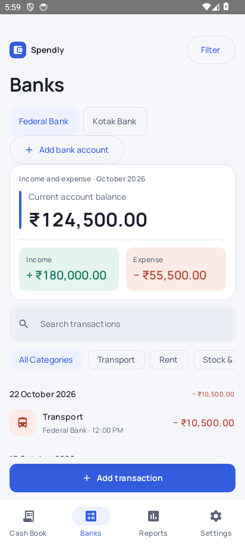
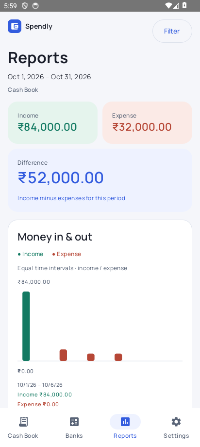
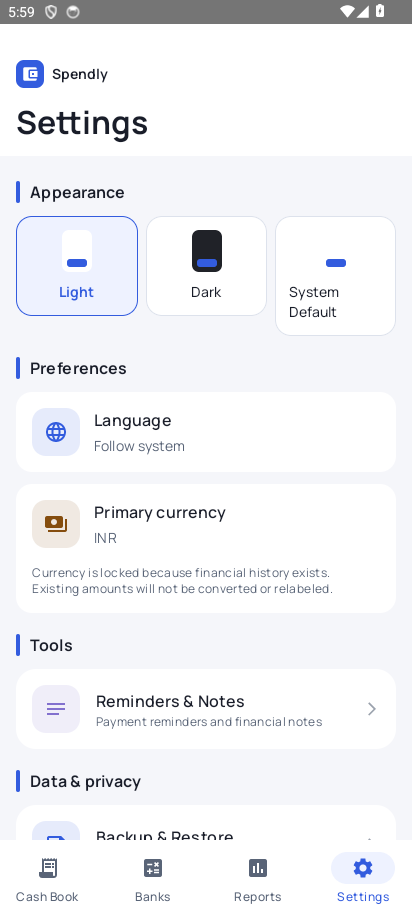
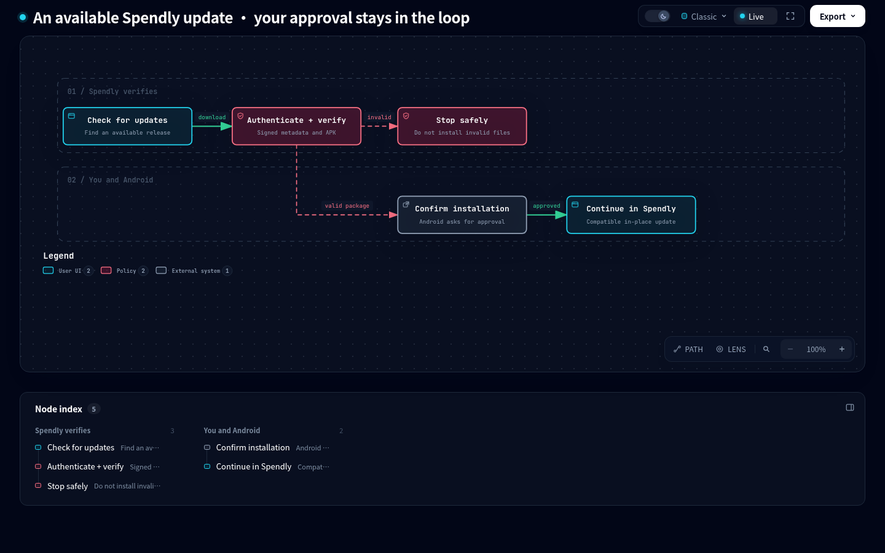

**A native Android cash book for the money moving through your day.**

[**↓ Get the Android app**](https://github.com/MohammedJabir18/Spendly-distribution/releases/latest) · [Explore the screens](#-a-closer-look) · [Install & update](#-install-once-update-in-the-app)

---
## Your cash. Your accounts. Your view.

Spendly helps you keep a cash book, separate bank ledgers and clear income/expense reports on Android. Financial records are maintained on your device; bank entries are manual, with no bank credentials required.

**This repository distributes the app.** It contains official APK releases, signed update metadata and public documentation/media. The application source repository is private.

## ✨ A closer look

<table>
<tr><th>Cash Book</th><th>Banks</th><th>Reports</th><th>Settings</th></tr>
<tr>
<td></td>
<td></td>
<td></td>
<td></td>
</tr>
</table>

☀️ Prefer the light side? Open the Light-mode gallery.

<table>
<tr><th>Cash Book</th><th>Banks</th></tr>
<tr><td></td><td></td></tr>
<tr><th>Reports</th><th>Settings</th></tr>
<tr><td></td><td></td></tr>
</table>

*Recorded native Android screens from the November 2026 design acceptance set, using demonstration data. These are screenshots, not a live session; later releases may differ.*

*An original brand animation, not a recording of an app interaction.*

## 🧭 Four tabs. A clearer day.

| Space | What you can do |
| :--- | :--- |
| **Cash Book** | Record cash income and expenses; see account balance and period totals. |
| **Banks** | Create multiple bank accounts, choose an account and keep its ledger separate. |
| **Reports** | Compare income and expenses, explore category totals and export PDF or Excel reports. |
| **Settings** | Choose appearance, language and primary currency; manage security, backups and updates. |

- **Move money with context.** Income, expense and transfers with dates, notes and transaction history editing/deletion subject to ledger validation.
- **Keep the screen quiet.** Day, week, month, year, custom range and all-time choices live inside the filter; the main view keeps the result in focus.
- **Read it your way.** Light/Dark themes; English, Malayalam, Arabic and Hindi, including RTL layouts.
- **Set one ledger currency.** INR, AED, SAR, QAR, KWD, BHD, OMR, USD, EUR, GBP and CHF. Three-decimal GCC currencies are represented with their correct minor-unit scale. This is not an exchange-rate or multi-currency conversion service.
- **Keep control.** Local financial storage, PIN/security controls and backup/restore. Bank accounts are manually maintained ledgers, not connections to your bank.

## 📲 Install once. Update in the app.

### First installation

1. [Download the official APK from Releases](https://github.com/MohammedJabir18/Spendly-distribution/releases/latest).
2. Open the downloaded file on an Android 8.0+ phone.
3. If Android asks, allow installation from the browser/file manager you used, then confirm installation.
4. Open Spendly and follow or skip the first-run guide.

### Already using Spendly?

**Install over the existing app. Do not uninstall first:** uninstalling can delete local records. Keep a current backup before an upgrade.

If your older build has no updater, install the official updater-enabled bootstrap once. Later versions can be checked, downloaded and verified inside Spendly, with Android confirmation to finish installation. If a signing/package mismatch is reported, stop and contact support; do not work around it by deleting your data.

[Explore the interactive Archify update flow](docs/readme/update-flow.html) — download the HTML and open it in a browser. GitHub renders the preview image; interactive HTML runs locally after opening.

### Current published bootstrap

| Item | Value |
| :--- | :--- |
| Release | **1.1.0**, version code **4** |
| Package | `com.spendly.android` |
| Minimum Android | 8.0 / API 26 |
| File | `Spendly-1.1.0-v4.apk` |
| Size | 2,541,210 bytes |
| SHA-256 | `c49e968446d40619c9036836a67413a95b9c4bb98c14de81ea80c44a4810425c` |

[**Download 1.1.0**](https://github.com/MohammedJabir18/Spendly-distribution/releases/download/v1.1.0/Spendly-1.1.0-v4.apk) · [All releases](https://github.com/MohammedJabir18/Spendly-distribution/releases) · [Signed channel metadata](release-envelope.json)

This table describes the bootstrap release, not a dynamically updated version badge. Later releases may supersede it.

## 🔐 What the updater checks

A pinned public key authenticates release metadata. The app verifies the downloaded APK's size, SHA-256, package, version and signing identity before handing it to Android's installer. The owner retains the private signing keys outside this repository.

Recorded release checks include an actual public-channel in-place upgrade, rotation during download, restart recovery before confirmation, wrong/correct PIN behavior and synthetic financial-record retention. Testing is scoped evidence, not a guarantee for every device.

Operator note: signed metadata has an expiry

The current signed envelope expires on **2027-02-03 UTC**. Maintainers must renew it before expiry. Expired/invalid metadata is rejected; changing an APK or the JSON payload requires a correctly signed release. Do not place keys or credentials in this repository.

## 💬 Need a hand?

[Email Mohammed Jabir](mailto:jabirahmedz111@gmail.com) with the Spendly version, Android version, phone model and steps to reproduce. Redact financial information. Never send your PIN or personal backup in a public issue.

- **Can't install?** Check Android version, storage and installation permission. A signature mismatch needs support, not an uninstall shortcut.
- **No update offered?** You may already have the published version; check your network and device date/time.
- **Can I connect my bank?** Accounts are manually maintained ledgers; bank-login integration is not included.
- **Can I convert currencies?** One primary ledger currency is supported; exchange-rate conversion is not included.
- **Is this open source?** No. Public APK access does not grant source publication or modification rights.

## 📄 License

Original Spendly materials use the [Proprietary License](LICENSE). Official app use and unchanged free sharing are permitted. Modified/rebranded distribution and resale need written permission. Third-party libraries and fonts retain their own licenses; a release-specific third-party notice audit remains outstanding. Earlier permissions validly granted under previous terms are not claimed to be retroactively revoked.

---

Project repositories: [Application source (private)](https://github.com/MohammedJabir18/Spendly) · [APK distribution](https://github.com/MohammedJabir18/Spendly-distribution)

### Made by Mohammed Jabir

[🌐 Website](https://mohammedjabir.me) · [GitHub](https://github.com/MohammedJabir18) · [LinkedIn](https://www.linkedin.com/in/mohammed--jabir) · [Email](mailto:jabirahmedz111@gmail.com)

[X / Twitter](https://twitter.com/mohammedjabir) · [Instagram](https://www.instagram.com/mohammedjabir/) · [Reddit](https://www.reddit.com/u/Mohammadjabir/s/usrcbZqXzK) · [☕ Buy me a coffee](https://buymeacoffee.com/mohammedjabir)

*Clear books. Calmer days.*
